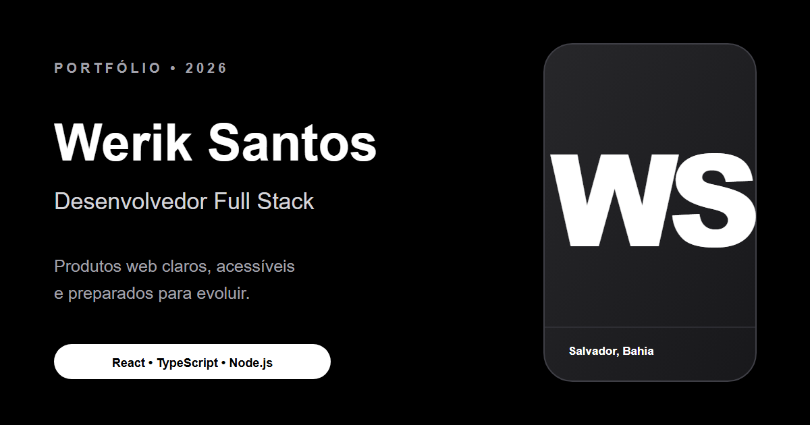

<p align="center">
  
</p>

<h1 align="center">Portfólio — Werik Santos</h1>

<p align="center">
  Aplicação web bilíngue criada para apresentar minha experiência, meus projetos e minha formação como Desenvolvedor Full Stack.
</p>

<p align="center">
  <a href="https://wasportifolio.vercel.app/">
    
  </a>
  <a href="https://www.linkedin.com/in/werik-santos/">
    
  </a>
  <a href="https://github.com/DevWerik">
    
  </a>
</p>

## Sobre o projeto

Este repositório contém a segunda versão do meu portfólio profissional. A aplicação reúne projetos apresentados como estudos de caso, experiência profissional, competências técnicas, certificados e canais de contato em uma interface responsiva, acessível e disponível em português e inglês.

O desenvolvimento prioriza código sustentável, navegação clara e uma experiência consistente em diferentes dispositivos e preferências de usuário.

## Destaques

- Conteúdo completo em **português e inglês**, com detecção do idioma do navegador e preferência salva localmente.
- Layout **responsivo**, navegação por teclado, skip link, gerenciamento de foco e marcação semântica.
- Animações com **GSAP e ScrollTrigger**, respeitando a preferência por movimento reduzido.
- Projetos organizados como **cases**, apresentando desafio, solução, resultado e tecnologias utilizadas.
- Formulário de contato com **React Hook Form**, **Zod**, Web3Forms, honeypot antispam e feedback de envio.
- SEO com canonical, Open Graph, Twitter Cards, JSON-LD, `robots.txt` e `sitemap.xml` gerados no build.
- Build otimizado com separação dos principais grupos de dependências e headers de segurança no deploy.

## Tecnologias

<p>
  
  
  
  
  
  
  
</p>

| Área | Tecnologias |
| --- | --- |
| Interface | React, TypeScript, Tailwind CSS, Base UI e shadcn |
| Animações | GSAP e ScrollTrigger |
| Formulários | React Hook Form, Zod e Web3Forms |
| Ícones | Lucide React e React Icons |
| Build e qualidade | Vite, ESLint, TypeScript e pnpm |
| Publicação | Vercel |

## Executando localmente

### Pré-requisitos

- Node.js `22.12` ou superior
- pnpm `10.6.5` ou compatível

### Instalação

```bash
git clone https://github.com/DevWerik/Portifolio-V2.git
cd Portifolio-V2
pnpm install
cp .env.example .env.local
```

No Windows PowerShell, substitua o último comando por:

```powershell
Copy-Item .env.example .env.local
```

Configure o arquivo `.env.local` antes de iniciar a aplicação:

| Variável | Descrição |
| --- | --- |
| `VITE_SITE_URL` | URL pública canônica em HTTPS, incluindo uma eventual subpasta e a barra final. |
| `VITE_WEB3FORMS_ACCESS_KEY` | Chave pública utilizada pelo formulário de contato do Web3Forms. |

Depois, inicie o servidor de desenvolvimento:

```bash
pnpm dev
```

A aplicação ficará disponível em `http://localhost:5173`.

## Scripts disponíveis

| Comando | Descrição |
| --- | --- |
| `pnpm dev` | Inicia o servidor de desenvolvimento. |
| `pnpm build` | Valida o TypeScript e gera o build de produção em `dist/`. |
| `pnpm preview` | Executa uma prévia local do build. |
| `pnpm lint` | Analisa os arquivos TypeScript e TSX com ESLint. |
| `pnpm typecheck` | Executa a verificação de tipos sem gerar arquivos. |

Antes de publicar uma alteração, execute:

```bash
pnpm lint
pnpm typecheck
pnpm build
```

## Estrutura do projeto

```text
Portifolio-V2/
├── public/                 # Imagens, ícones, certificado e arte social
├── src/
│   ├── components/         # Seções e componentes reutilizáveis
│   ├── i18n/               # Idiomas, persistência e metadados localizados
│   ├── layouts/            # Navbar, página principal e rodapé
│   ├── lib/                # Utilitários, assets públicos e configuração do GSAP
│   ├── App.tsx             # Composição principal da interface
│   └── main.tsx            # Inicialização da aplicação
├── .env.example            # Exemplo das variáveis de ambiente
├── vercel.json             # Build e headers de segurança da Vercel
└── vite.config.ts          # Vite, SEO, URL base e divisão de bundles
```

## Deploy

O projeto está preparado para publicação na Vercel. O arquivo [`vercel.json`](./vercel.json) define o preset Vite, o comando de build, a pasta de saída e os headers básicos de segurança.

No ambiente de produção, configure `VITE_SITE_URL` e `VITE_WEB3FORMS_ACCESS_KEY`. Alterações nessas variáveis exigem um novo deploy. Ao conectar um domínio próprio, atualize `VITE_SITE_URL` para a nova URL canônica e faça um envio real pelo formulário para validar a integração.

## Contato

Quer conversar sobre um projeto ou oportunidade?

- [LinkedIn](https://www.linkedin.com/in/werik-santos/)
- [GitHub](https://github.com/DevWerik)
- [E-mail](mailto:werikanjos02@gmail.com)

---

<p align="center">
  Desenvolvido por <a href="https://github.com/DevWerik">Werik Santos</a>.
</p>
